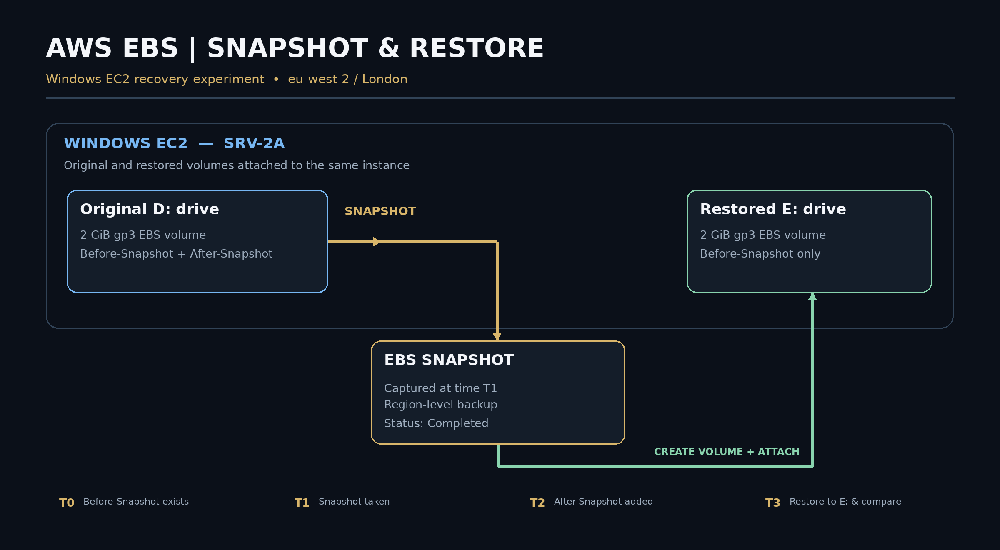
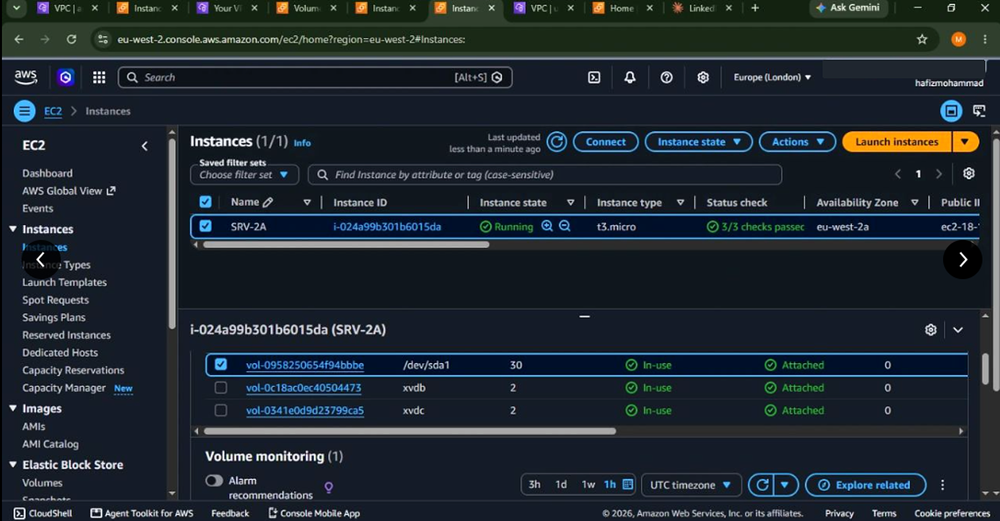
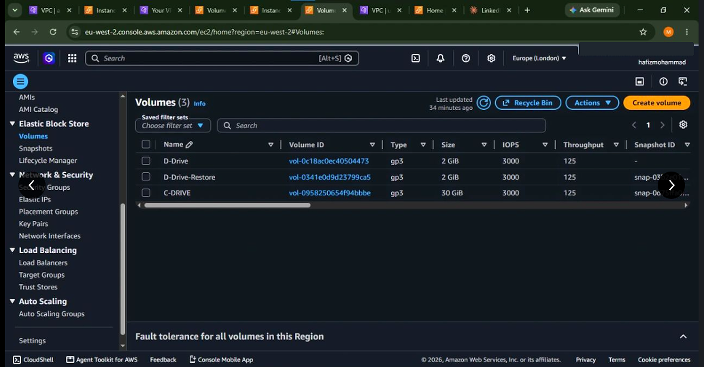
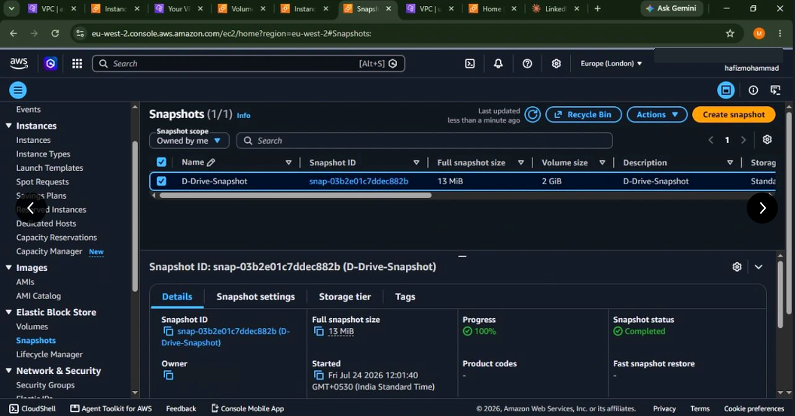
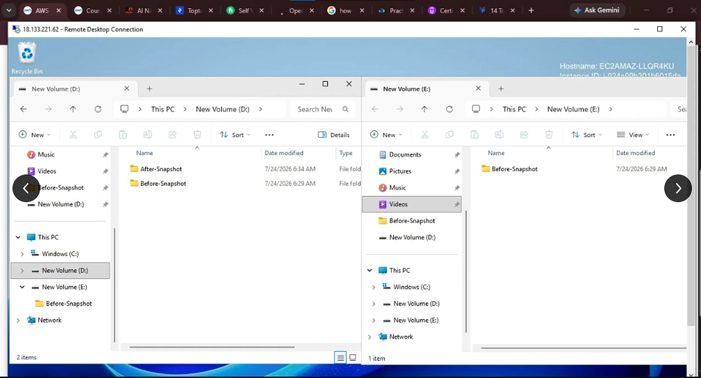

# AWS EBS Snapshot & Disaster Recovery

### A hands-on Windows EC2 recovery experiment — where the restored disk preserved the snapshot-time data, not the later changes.

**Amazon EC2 · EBS gp3 · EBS Snapshots · Windows Server · Backup & Restore · Cloud Infrastructure Troubleshooting**

> **Engineering question:** If the contents of a live disk change after a backup is taken, what exactly comes back when we restore that backup?

**Verified in the supplied screenshots:** a completed EBS snapshot, a restored 2 GiB volume attached alongside the original 2 GiB volume, and a Windows file-explorer comparison showing `Before-Snapshot` on both drives while `After-Snapshot` appears only on the original drive.

**Project type:** Personal hands-on AWS training lab, not a production disaster-recovery deployment.  
**Environment:** Windows EC2 instance `SRV-2A`, Europe (London) `eu-west-2`; original volume `D:` and restored volume `E:`.  
**Project date:** July 2026, based on the snapshot screenshot; portfolio case study prepared in October 2026.

[**Engineering Deep Dive**](DEEP-DIVE.md) · [**Architecture**](docs/ARCHITECTURE.md) · [**Implementation**](docs/IMPLEMENTATION.md) · [**Validation**](docs/VALIDATION.md) · [**Troubleshooting**](docs/TROUBLESHOOTING.md) · [**Evidence Index**](docs/EVIDENCE-INDEX.md)

---

## 01 — The problem worth solving

A storage backup is only useful if it can restore the data you intended to protect. Seeing a green **Snapshot: Completed** status is important, but it doesn't answer the harder question: *What would a user see after the backup was turned back into a readable disk?*

This project deliberately introduced a simple form of **data drift** between the snapshot and the live volume:

1. Create baseline content (`Before-Snapshot`) on the Windows data volume.
2. Create an EBS snapshot at time **T1**.
3. Add `After-Snapshot` to the original volume **after** T1.
4. Create a new EBS volume from the snapshot and attach it to the EC2 instance.
5. Compare original `D:` and restored `E:` side by side.

The restored volume contains the baseline folder, but not the later folder. That is exactly the boundary a point-in-time snapshot is meant to capture.

## 02 — Result in one glance

| Check | Observed result | Evidence |
|---|---|---|
| Windows EC2 online | `SRV-2A` running with attached volumes | [EC2 attachments](evidence/01-windows-ec2-and-attached-volumes.png) |
| Source and restored EBS | Two named 2 GiB gp3 volumes appear | [EBS volumes](evidence/02-original-and-restored-ebs-volumes.png) |
| Snapshot backup | `D-Drive-Snapshot` marked **Completed / 100%** | [Snapshot](evidence/03-snapshot-completed.png) |
| Restore comparison | `D:` shows **Before + After**; `E:` shows **Before only** | [Windows comparison](evidence/04-before-vs-after-recovery.png) |

**What this proves:** a restored volume was accessible with content matching the visible snapshot-time state.  
**What this does not prove:** file checksums, crash/application consistency, zero RPO, automatic recovery, an end-to-end availability SLA, or preservation of post-snapshot writes.

## 03 — Architecture and recovery flow



**Service-level interpretation:**

- **Amazon EC2** runs Windows and provides the OS environment where disks are mounted.
- **Original EBS volume** is a block device presented to Windows as the `D:` data drive.
- **Amazon EBS Snapshot** stores a point-in-time backup managed by AWS; it is **not** a user-visible S3 bucket.
- **Restored EBS volume** is a *new* 2 GiB volume built from the snapshot and attached to the same instance as `E:`.
- **Windows comparison** reveals which folder state was included in the snapshot.

AWS EBS volumes are attached within an Availability Zone; a new volume restored from a regional snapshot can be created in the AZ of the destination EC2 instance.

[Read the architecture decisions →](docs/ARCHITECTURE.md)

## 04 — The actual sequence

| Stage | Operation | Expected state |
|---|---|---|
| **Baseline** | Populate source `D:` with `Before-Snapshot` | Data exists before backup |
| **Backup** | Create EBS snapshot of data volume | AWS snapshot reaches `Completed` |
| **Drift** | Add `After-Snapshot` on `D:` | Live disk advances beyond backup |
| **Restore** | Create new volume from snapshot | Restored volume reflects earlier state |
| **Mount** | Attach restored EBS volume to EC2 and bring disk online as `E:` | Both drives readable |
| **Verify** | Compare folder listings side by side | `Before-Snapshot` on both; `After-Snapshot` on `D:` only |

These steps reconstruct the demonstrated workflow from your screenshots and project description; **they are not an exported command transcript**.

[Walk through the complete implementation →](docs/IMPLEMENTATION.md)

## 05 — Real screenshots, enhanced for readability

All four screenshots below are derived from original images supplied for this project. They were **upscaled and lightly sharpened** for easier viewing; AWS account-number displays have been masked. *No statuses, timestamps, folder results, or resource values were fabricated or replaced.*

**1. Instance and volume attachments**  


**2. Original and restored EBS data volumes**  


**3. Snapshot reaches Completed**  


**4. Side-by-side file recovery evidence**  


[See evidence notes and limitations →](docs/EVIDENCE-INDEX.md)

## 06 — The engineering challenge: restoring is not the same as protecting every change

A single snapshot is a **recovery checkpoint**, not continuous protection. It cannot contain writes made after the snapshot was requested. The test intentionally demonstrates this by leaving `After-Snapshot` on `D:` while `E:` contains only `Before-Snapshot`.

This matters when deciding an acceptable **Recovery Point Objective (RPO)**. If a critical application requires minimal data loss, a once-per-day snapshot may be insufficient. For those systems you may need more frequent backups, application-aware protection, database transaction-log backups, or other suitable mechanisms.

**Further reliability questions** (not tested in this project):

- Can we recover using a fresh EC2 instance in another Availability Zone?
- Can we demonstrate application-consistent snapshots using Windows VSS?
- Can we measure elapsed **Recovery Time Objective (RTO)** accurately?
- Can we validate recovered files using cryptographic hashes instead of folder names alone?
- Can we automate scheduled backup retention and test restores?

[Deep Dive: RPO, RTO, crash consistency and snapshot mechanics →](DEEP-DIVE.md)

## 07 — Troubleshooting and lessons learned

During this lab, a Windows **offline disk / disk signature collision** issue was reported when exposing both original and restored disks. The workaround described in the project notes involved correcting the Windows disk configuration. This issue is included as a **reported troubleshooting experience**, but no error-screen screenshot or command transcript has been supplied to independently verify its exact remediation sequence.

**Lesson:** AWS can attach the underlying block volume correctly while Windows still does not present the disk as a usable drive letter. Debugging needs to cross both layers:

`AWS EBS status → EC2 attachment → Windows disk visibility → online/offline state → file-system mount → recovered data`

[Review a cautious, step-by-step troubleshooting guide →](docs/TROUBLESHOOTING.md)

## 08 — Repository map

```text
aws-ebs-disaster-recovery/
├── README.md                # Recruiter landing page
├── DEEP-DIVE.md             # Beginner-to-advanced engineering handbook
├── docs/
│   ├── ARCHITECTURE.md
│   ├── IMPLEMENTATION.md
│   ├── VALIDATION.md
│   ├── TROUBLESHOOTING.md
│   └── EVIDENCE-INDEX.md
├── diagrams/
│   └── architecture.png
└── evidence/
    ├── 01-windows-ec2-and-attached-volumes.png
    ├── 02-original-and-restored-ebs-volumes.png
    ├── 03-snapshot-completed.png
    └── 04-before-vs-after-recovery.png
```

**One `evidence/` folder. No `raw/` and `enhanced/` duplicates.** The original uploads should be preserved privately as separate archival material.

## 09 — Technical depth and future improvements

I approached this exercise as more than a console-click demonstration. The relevant engineering skills are **block storage**, **recovery boundaries**, **AWS-to-Windows troubleshooting**, **verification**, and **being precise about what the evidence can prove**.

The natural follow-up is to introduce failure explicitly (data corruption or accidental deletion in a disposable lab), perform a timed restore, compare file hashes, and publish an incident-style recovery report.

## Author

**Hafiz Mohammad Sunasara**  
Cloud & DevOps engineering learner | AWS · Linux · Containers · Networking · Disaster Recovery  
[GitHub](https://github.com/HafizMohammadSunasara) · [LinkedIn](https://www.linkedin.com/in/hafiz-mohammad-sunasara-118756366)

---

### Technical references

- [AWS — Create Amazon EBS snapshots](https://docs.aws.amazon.com/ebs/latest/userguide/ebs-creating-snapshot.html)
- [AWS — How Amazon EBS snapshots work](https://docs.aws.amazon.com/ebs/latest/userguide/how_snapshots_work.html)
- [AWS — Create EBS volume from a snapshot](https://docs.aws.amazon.com/ebs/latest/userguide/ebs-creating-volume.html)
- [AWS — Windows VSS application-consistent snapshots](https://docs.aws.amazon.com/AWSEC2/latest/UserGuide/application-consistent-snapshots.html)
